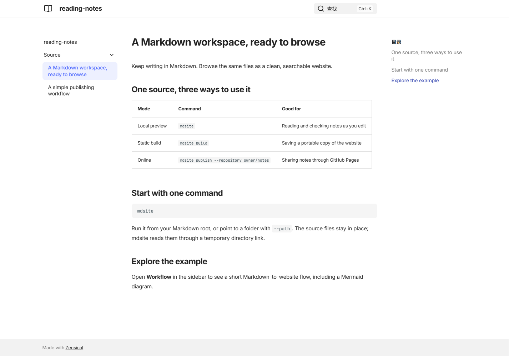

# mdsite

[](https://github.com/int2t05/mdsite/actions/workflows/ci.yml)
[](https://pypi.org/project/mdsite/)
[](LICENSE)

Turn a Markdown folder into a browsable website. `mdsite` reads the original files through a temporary directory link; it does not copy or rewrite them.



## Use

Install [uv](https://docs.astral.sh/uv/), then run this from your Markdown folder:

```powershell
uvx mdsite
```

The site opens at `http://127.0.0.1:8000`. Stop it with `Ctrl+C`.

```powershell
uvx mdsite build
```

This creates a static site in `site/`.

## Publish online

Sign in once with [GitHub CLI](https://cli.github.com/) using `gh auth login`. From your Markdown folder, run:

```powershell
uvx mdsite publish --repo owner/repository --create-repository
```

The command creates the public GitHub repository if needed and publishes the site with GitHub Pages. Published sites are public; only publish files that are safe to share.

Run the same command again to update the site. `mdsite` rebuilds navigation and search, then commits only changed site files; an unchanged build creates no commit. Files removed from the source are removed from the published site. Publish commits use the authenticated GitHub account as author and committer.

## Features

- Markdown, Mermaid diagrams, and MathJax formulas.
- Read-only pages for Python and common text/code files appear under their original folders in the navigation, with syntax highlighting and line numbers. Supported types include `.py`, `.pyi`, `.txt`, `.json`, YAML, TOML, INI, shell, PowerShell, JavaScript/TypeScript, HTML/CSS, SQL, R, Julia, Rust, Go, Java, C/C++, XML, TeX, CSV, and diff. UTF-8 files up to 1 MiB are shown; hidden files, links, and common build/cache directories are skipped.
- Source files stay in their original folder.
- Python 3.11 or newer.

## Development

```powershell
uv sync --locked --all-groups
uv run ruff check .
uv run python -m unittest discover -s tests
uv build
```

## License

MIT; see [LICENSE](LICENSE).
