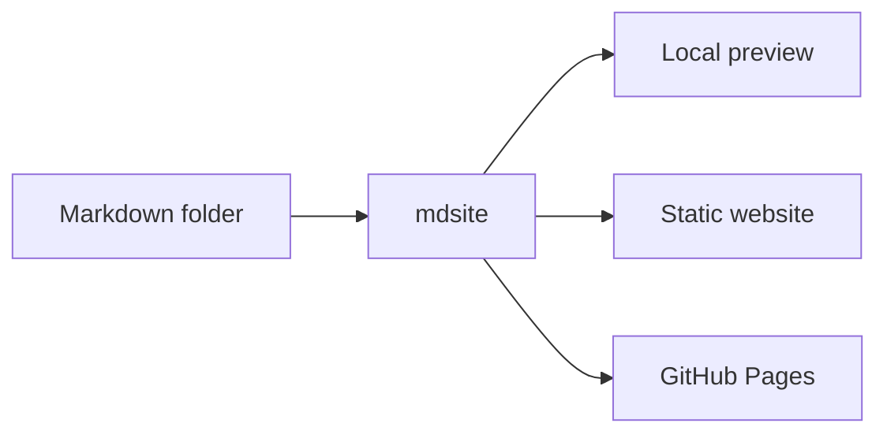

# A simple publishing workflow

The same Markdown folder can be previewed locally, built into static files, or shared online.

## Preview locally

~~~powershell
mdsite --path "D:\notes"
~~~

## Publish online

After signing in with `gh auth login`, publish to an existing repository or create a public one:

~~~powershell
mdsite publish --path "D:\notes" --repository "owner/notes" --create-repository
~~~

The Pages site is public, while the original Markdown folder remains on your computer.
